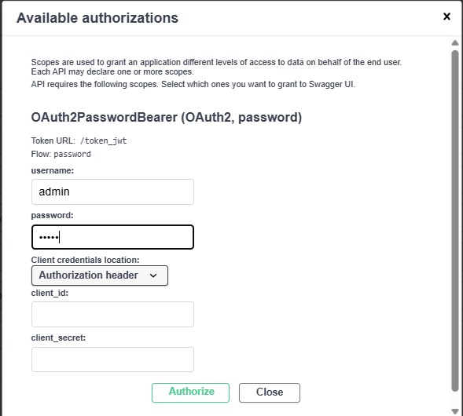
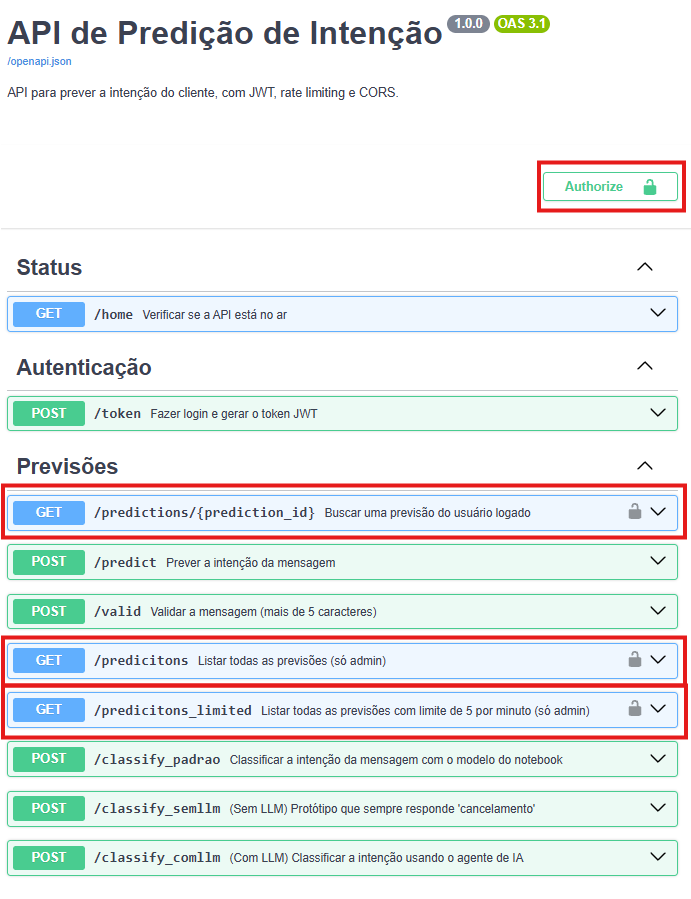

# EXCUTAR APLICAÇÃO COMPLETO

```bash
# Na pasta da "\fastapi" , criar o .venv com as dependências e iniciara a aplicação
py -m venv .venv --upgrade-deps
.venv\Scripts\Activate.ps1
py -m pip install -r requirements.txt
# executar
uvicorn main:app --reload

# ou executar
uvicorn main:app --port 8000 --reload

# ou executar
fastapi dev main.py
```

## Rodar Testes Automatizados

```bash
# Dentro do ambinte virtual .venv
py -m pytest -v
```

## Rodar arquivo ipynb

```bash
# Dentro do ambiente virtual .venv
jupyter nbconvert --execute --inplace "EDA_Bitext_Sample_Customer_Service.ipynb"

# Dentro do ambiente virtual .venv de forma interativa(da pra visualizar as celulas que ja foram executados com o resultado parcial)
papermill "EDA_Bitext_Sample_Customer_Service.ipynb" "EDA_Bitext_Sample_Customer_Service.ipynb" --log-output

# Confirmar que excutou tudo sem erro
$LASTEXITCODE
```

## Pré-requisitos

- VS Code
- Python 3.10 ou superior
- pip
- **Só no Windows:** permitir execução de scripts no PowerShell (necessário só uma vez)

```bash
Set-ExecutionPolicy -Scope Process -ExecutionPolicy Bypass
```

## Instruções de instalação

1. Clone o repositório:

```bash
git clone https://github.com/<usuario>/<nome-do-repositorio>.git
cd <nome-do-repositorio>
```

2. Abra o projeto e acesse a pasta da API:

```bash
cd .\fastapi
```

3. Crie e ative um ambiente virtual:
   - Verifique se está dentro da pasta "fastapi"

```bash
# Criar mabiente virtual
py -m venv .venv

# Ative o ambiente virtual
.venv\Scripts\Activate.ps1
```

4. Instale as dependências a partir do arquivo requirements.txt:

```bash
py -m pip install -r requirements.txt
```

5. Verifique se foi instalado corretamente (deve aparecer name, location e outras informações sobre o pacote)

```bash
py -m pip show fastapi
```

## Instruções de execução

1. Acesse a pasta da API e certifique-se de que o ambiente virtual está ativado (veja passo 3 da instalação, caso tenha aberto um novo terminal):

```bash
cd .\fastapi
```

2. Execute a aplicação:

```bash
uvicorn main:app --reload

# ou executar
uvicorn main:app --port 8000 --reload

# ou executar
fastapi dev main.py
```

3. A API estará disponível em:
   http://127.0.0.1:8000/docs

# Extras

1. Apagar tudo e recriar o ambiente virtual

   **Windows (PowerShell):**

```bash
deactivate
# remover .venv
Remove-Item -Recurse -Force .venv

# limpar py-chache
Get-ChildItem -Path . -Include __pycache__ -Recurse -Directory | Remove-Item -Recurse -Force
```

2. Criar requirements.txt

```bash
# Dentro do .venv
py -m pip freeze > requirements.txt
```

<details>
<summary>Acesar rotas protegidas</summary>
1. Conforme imagem abaixo, clique em Authorize e informe usuário (admin)  e senha (admin)



2. Após estar autenticado voce poderá acessar a rota 'listar_produtos_limite_protegido'

Obs. na pratica é igual a outra rota, porém agora necessita de autenticaçã o para acesso



</details>

# 🧪 Testes no Swagger

O servidor subiu. Agora é testar tudo no Swagger: abra `http://localhost:8000/docs`.

---

## 1️⃣ Testar `/classify_padrao`

Essa é a rota do **modelo treinado**. **Não precisa de login.**

- Clique em `POST /classify_padrao` → **Try it out**
- Mande a mensagem **em inglês**, porque o modelo foi treinado em inglês:

```json
{ "message": "I want to cancel my order" }
```

- Clique em **Execute**. O esperado é `200`:

```json
{ "intent": "cancel_order", "probability": 0.99 }
```

- Teste também `{"message": "I need help"}`. Deve dar `contact_human_agent` com mais ou menos **0,21** (igual à aula)
- ⏳ A **primeira chamada demora mais**, porque carrega o modelo do disco. As próximas são rápidas

---

## 2️⃣ Testar `/classify_semllm`

Essa rota é só um **protótipo**, **sem LLM**.

- Mande **qualquer mensagem**. A resposta é **sempre a mesma**: `cancelamento` com `0.99`
- Ela serve só para mostrar o **formato da resposta**

---

## 4️⃣ Testar `/classify_comllm_groq`

Essa é a rota do **agente com o Groq** (LLM **grátis**), no lugar da OpenAI.

- Precisa da `GROQ_API_KEY` no `.env` (grátis em `https://console.groq.com/keys`).
- Clique em `POST /classify_comllm_groq` → **Try it out**
- Mande:

```json
{ "message": "I want to cancel my order" }
```

- Clique em **Execute**. O esperado é `200`, parecido com isto:

```json
{ "response": "Intenção: cancel_order. Probability: 0.99" }
```

- Funciona igual ao `/classify_comllm`, mas **sem gastar crédito** (usa o modelo `openai/gpt-oss-20b` do Groq)

---

## 🚧 Testes de borda (opcional)

Esses testes mostram as **validações** da API:

- `{"message": "   "}` (só espaços) → `422` com a mensagem **"A mensagem não pode estar vazia"**
- `{"message": "oi", "extra": 1}` → `422`, porque o **campo extra** é barrado pelo `extra="forbid"`

---

## ⚠️ Se der erro

Se o `/classify_padrao` e o `/classify_semllm` funcionarem, mas a rota do agente der erro, veja **qual erro aparece no terminal**.

- **`/classify_comllm` (OpenAI):** o mais comum é a chave **sem crédito** (`insufficient_quota`). Esse é justamente o caso que o **Groq** (aula 16) resolve — use a rota `/classify_comllm_groq`.
- **`/classify_comllm_groq` (Groq):** se fizer **muitas chamadas seguidas**, pode dar `429` (limite do plano grátis por minuto). É só **esperar um pouco** e tentar de novo.
